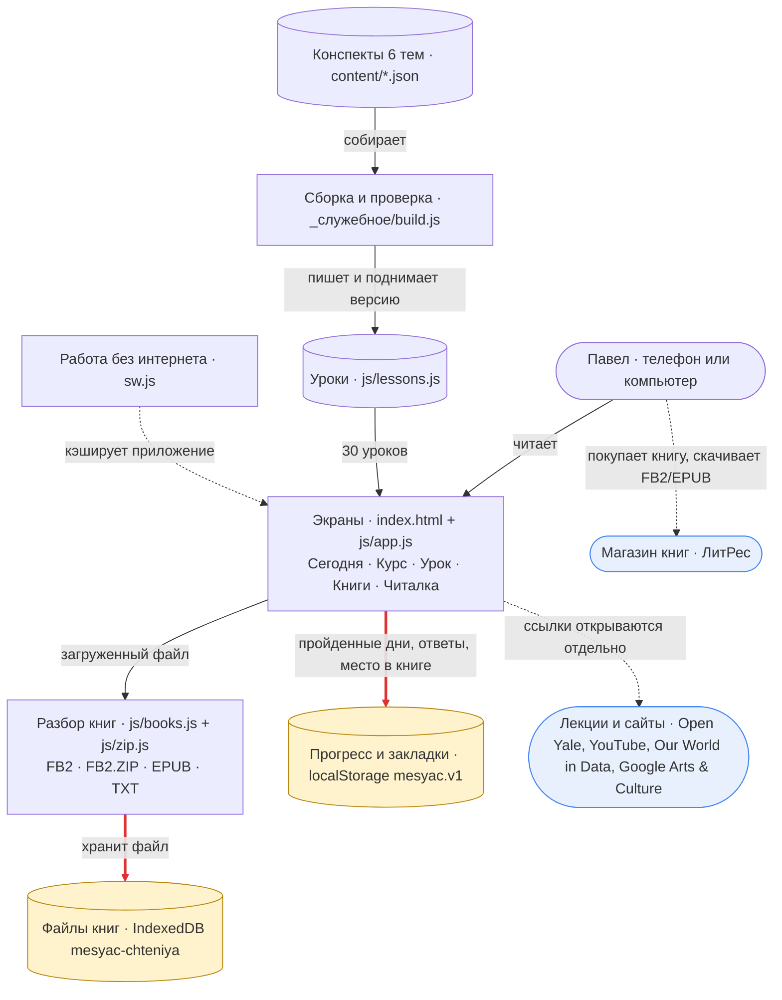

# Месяц чтения — карта архитектуры

Обновлена 01.11.2026. Та же схема для двойного клика — `Карта.html`, правятся вместе.

Приложение на телефон по рилсу «6 тем за месяц»: 30 уроков-конспектов, ссылки на лекции и сайты,
читалка своих книг. Сервера нет: всё работает в браузере телефона, данные — только в телефоне.

**Легенда**
- **Синие** — внешние сайты: магазин книг и открытые лекции. Приложение их только открывает ссылкой, данных туда не шлёт.
- **Янтарные** — данные, которые живут только в этом телефоне: прогресс и файлы книг. Очистка данных сайта в браузере их сотрёт.
- **Красные линии** — запись этих данных.
- **Пунктир** — необязательные пути: кэш для офлайна, покупка книги, внешние ссылки.
